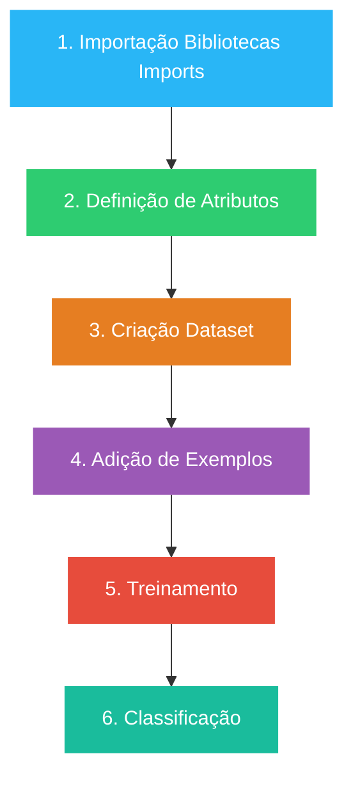

# Configuração da IDE para Weka e Java

O desenvolvimento e a execução deste projeto foram realizados utilizando a IDE **IntelliJ IDEA**, que gerencia de forma integrada as dependências do Maven e o ciclo de vida do Spring Boot.

Configuração das Depêndencias do `pom.xml`

## Configuração do Java

Define a versão do java utilizada no projeto, garantindo compatibilidade com **java 21**

```xml
    <properties>
        <java.version>21</java.version>
    </properties>
```

## Dependência do Weka

Inclui o **Weka** (`weka-stable` na versão **3.8.7**), permitindo que o projeto utilize **Machine Learning**.

```xml
    <dependency>
        <groupId>nz.ac.waikato.cms.weka</groupId>
        <artifactId>weka-stable</artifactId>
        <version>3.8.7</version>
    </dependency>
```

# Configuração do Spring boot


### Depêndencias no `pom.xml`

```xml
    <!-- Spring Data JPA -->
    <dependency>
        <groupId>org.springframework.boot</groupId>
        <artifactId>spring-boot-starter-data-jpa</artifactId>
    </dependency>

    <!-- Hibernate Community Dialects -->
    <dependency>
        <groupId>org.hibernate.orm</groupId>
        <artifactId>hibernate-community-dialects</artifactId>
    </dependency>

    <!-- Validação de Campos -->
    <dependency>
        <groupId>org.springframework.boot</groupId>
        <artifactId>spring-boot-starter-validation</artifactId>
    </dependency>

    <!-- Ferramentas de Desenvolvimento -->
    <dependency>
        <groupId>org.springframework.boot</groupId>
        <artifactId>spring-boot-devtools</artifactId>
    </dependency>

    <!-- Spring Boot Web -->
    <dependency>
        <groupId>org.springframework.boot</groupId>
        <artifactId>spring-boot-starter-web</artifactId>
    </dependency>
```

# Processos Essenciais para Machine Learning




### 1. Importação de Bibliotecas (Imports)

Esta etapa inicial consiste na configuração do ambiente de desenvolvimento Java, trazendo para o código-fonte os pacotes nativos da API do Weka. Nela, mapeiam-se as dependências necessárias para a manipulação de dados estruturados e para a invocação dos algoritmos de aprendizado de máquina.
- **Componentes chaves no ecossistema Weka**: Inclusão de classes estruturais como `weka.core.Instances` (para representação de conjuntos de dados), `weka.core.converters.ConverterUtils.DataSource` (para leitura de arquivos) e os pacotes de classificadores contidos em `weka.classifiers`.


### 2. Definição de Atributos

No contexto do **Weka**, os dados precisam ser explicitamente tipados e estruturados. Nesta fase, define-se a semântica de cada coluna do problema: quais características representam as variáveis preditoras (atributos de entrada) e qual coluna representa o rótulo ou variável alvo (o _Target_).
- **Ação sistêmica**: O **Weka** exige que o programador defina rigorosamente o índice da classe antes de iniciar qualquer operação. Isso é comumente realizado instruindo o sistema a olhar para uma coluna específica da tabela (frequentemente a última) como a resposta a ser prevista.

### 3. Criação do Dataset

Esta etapa envolve a carga dos dados brutos armazenados em disco para a memória volátil da aplicação. O Weka trabalha nativamente com arquivos no formato **ARFF** (_Attribute-Relation File Format_), mas também suporta extensões comuns como **CSV**. O sistema lê o cabeçalho do arquivo, valida os tipos de dados (numéricos, nominais, strings) e cria uma estrutura de matriz na memória.
- **Ação sistêmica**: Os dados são instanciados e validados semanticamente. É também neste ponto que estratégias de amostragem ou divisão de dados (como separar uma fração para validação posterior) podem ser programadas.


### 4. Adição de Exemplos

Consiste na alimentação da base de dados com registros históricos ou instâncias reais (as linhas da tabela). Para que ocorra o aprendizado indutivo, o sistema necessita de uma amostragem representativa do problema. Cada exemplo deve conter o conjunto completo de atributos definidos no Passo 2, acompanhado do respectivo rótulo correto já conhecido.
- **Ação sistêmica**: Na API, cada linha de dados é representada pela classe `Instance`. O acúmulo ordenado dessas instâncias consolida o volume informacional que servirá de insumo para os cálculos estatísticos do algoritmo.

### 5. Treinamento

Esta é a fase puramente analítica e matemática do processo. Um algoritmo de classificação específico (como Árvores de Decisão _J48_, _Naive Bayes_ ou _Random Forest_) é instanciado e alimentado com o dataset estruturado nos passos anteriores. O algoritmo varre os exemplos em busca de padrões, correlações e regras de decisão, ajustando seus pesos e parâmetros internos até convergir em um modelo preditivo otimizado.
- **Ação sistêmica**: O método principal disparado nesta fase é o `.buildClassifier()`. Ao término da execução, o objeto abstrato do classificador transforma-se em um modelo lógico concreto, pronto para inferências.

### 6. Classificação

A etapa final corresponde à execução e entrega de valor do sistema de IA. Com o modelo lógico consolidado e treinado, a aplicação pode receber um novo registro isolado (uma nova `Instance`), contendo apenas os atributos descritivos, sem a resposta. O classificador processa esses novos fatores sob a ótica das regras que aprendeu no treinamento e faz uma inferência, rotulando ou **classificando** o novo dado em uma das categorias predefinidas.
- **Ação sistêmica**: A aplicação utiliza o método `.classifyInstance()` para retornar um índice numérico correspondente à classe prevista pelo modelo para o novo dado apresentado.

# Sistema Inteligente de Detecção de Fraude Bancária

Abaixo constam as informações geradas pela execução prática do algoritmo J48 sobre o cenário implementado na aplicação, demonstrando a árvore de inferência e a validação do lote de testes.

## Relatório de Treinamento e Mineração Estatística (`J48`)

O algoritmo `J48` implementado pelo Weka baseia-se na árvore de decisão Quinlan C4.5. O princípio matemático central baseia-se na redução da **entropia** e na maximização do **ganho de Informação** para selecionar o melhor atributo de divisão para cada nó da árvore.

_Em Machine Learning (Aprendizado de Máquina), a **entropia** é uma métrica emprestada da Teoria da Informação (e originalmente da termodinâmica) que mede o nível de desordem, incerteza ou impureza em um conjunto de dados._

Ao compilar o histórico de treino fornecido no código, a representação estrutural da árvore foi:

```text
=== ESTRUTURA DA ÁRVORE DE DECISÃO (J48) ===
J48 pruned tree
------------------

valor <= 500: nao (4.0)
valor > 500: sim (7.0)

Number of Leaves  : 	2

Size of the tree : 	3

============================================
```

## Diagnóstico de Relevância de Recursos (_Feature Relevance_)

Analisando matematicamente o dataset fornecido, nota-se que a variável categórica `origem` sofreu uma **poda total por falta de ganho informacional**.
Como a base histórica de exemplos foi construída de forma linear, todas as ocorrências rotuladas como legítimas (`fraude = nao`) possuíam valores abaixo ou exatamente iguais a R$ 500. Por outro lado, todas as instâncias rotuladas como fraude (`fraude = sim`) possuíam valores superiores a R$ 500.

Para a matemática do algoritmo, segregar os dados pelo valor foi suficiente para zerar a entropia do dataset. Portanto, gerar ramificações baseadas em `origem` seria redundante e violaria o princípio da navalha de Ockham, resultando em uma árvore otimizada de apenas duas folhas.

## Relatório de Validação de Testes Computacionais

O lote automático contendo 10 transações independentes foi injetado no classificador treinado. Abaixo, detalha-se o comportamento preditivo para cada cenário simulado:


| ID | Valor (Numérico) | Origem (Nominal) | Resultado Preditivo | Parecer de Comportamento Sistêmico |
| :--- | :--- | :--- | :--- | :--- |
| **01** | R\$ 5.000 | internacional | **Fraude: sim** | **Aprovado.** Estourou o teto do nó de corte (`valor > 500`). |
| **02** | R\$ 200 | nacional | **Fraude: nao** | **Aprovado.** Classificado na folha de conformidade doméstica (`valor <= 500`). |
| **03** | R\$ 10.000 | internacional | **Fraude: sim** | **Aprovado.** Sinalizado como alto risco pelo volume transacionado. |
| **04** | R\$ 150 | nacional | **Fraude: nao** | **Aprovado.** Movimentação de baixo valor e dentro do padrão regular. |
| **05** | R\$ 7.000 | internacional | **Fraude: sim** | **Aprovado.** Padrão severo detectado pelo teto matemático. |
| **06** | R\$ 300 | nacional | **Fraude: nao** | **Aprovado.** Transação de rotina validada pela folha correspondente. |
| **07** | R\$ 8.000 | internacional | **Fraude: sim** | **Aprovado.** Classificação de alto risco financeiro validada. |
| **08** | R\$ 400 | nacional | **Fraude: nao** | **Aprovado.** Transação validada com sucesso pelo modelo matemático. |
| **09** | R\$ 9.000 | nacional | **Fraude: sim** | **Alerta de Falso Positivo (Rígido):** O modelo rotulou o teste como fraude devido ao valor exorbitante, ignorando a origem "nacional". Em cenários reais, grandes compras domésticas legítimas gerariam bloqueios indevidos por falta de regras contextuais. |
| **10** | R\$ 309 | internacional | **Fraude: nao** | **Vulnerabilidade de Segurança Crítica (Falso Negativo):** Uma transação internacional, comumente de maior risco regulatório, passou sem alertas no sistema porque seu valor estava abaixo de R\$ 500. Isso evidencia um viés gerado pela ausência de exemplos de fraudes internacionais de menor valor na base de treinamento histórica. |


## Como Rodar o Projeto no IntelliJ IDEA

A execução e o gerenciamento do ciclo de vida da aplicação podem ser feitos de forma totalmente visual e nativa na interface do **IntelliJ IDEA**:

1. **Sincronizar Dependências do Maven**:
   - No canto direito da janela do **IntelliJ**, abra o menu lateral escrito **Maven**, icone **M**.
   - Clique no ícone superior composto por **duas setas em círculo** (_Sync All Maven Projects_) para que a IDE baixe e indexe os arquivos de dependência do **Weka** automaticamente.
2. **Executar a Classe Principal**:
   - No painel de navegação de arquivos do projeto (lado esquerdo do **IntelliJ**), localize a classe principal pelo caminho: `src/main/java/com/ia/projectwithweka/ProjectWithWekaApplication.java`.
   - Clique com o botão direito sobre o arquivo e selecione a opção **Run 'ProjectWithWekaApplication'**, ou clique no botão de **Play verde (▶)** posicionado diretamente na calha ao lado da declaração do método `main`.
3. **Leitura de Resultados**:
   - A aba inferior **Run** do **IntelliJ** será carregada automaticamente, exibindo os relatórios de logs, o mapeamento final dos 10 testes de fraude direto no console da IDE e o a árvore estrutural criada pelo J48.

# Conclusão do Projeto

Este projeto cumpriu seu objetivo didático de demonstrar, de forma prática e simplificada, como integrar a biblioteca **Weka** ao ecossistema **Spring Boot** para criar um motor de Inteligência Artificial do zero.

A implementação do algoritmo **J48 (Árvore de Decisão)** permitiu compreender na prática como uma máquina analisa dados históricos para extrair regras lógicas e tomar decisões automatizadas. O experimento evidenciou a importância da qualidade e do balanceamento dos dados de treinamento: por ser um cenário simples de testes, o modelo focou puramente na variável de maior impacto (o valor da transação), demonstrando de forma clara como os algoritmos de Machine Learning operam buscando a lógica mais direta para a resolução de problemas.

O projeto serve como uma excelente base de estudos para entender o fluxo essencial de Ciência de Dados (coleta, estruturação, treino e classificação) dentro do ambiente **Java**.

