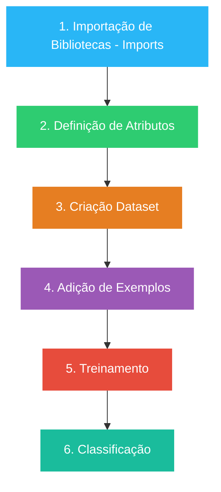

# Configuração da IDE para Weka e Java

Configuração das Depêndencias do `pom.xml`

## Configuração do Java

Define a versão do java utilizada no projeto, garantindo compatibilidade com **java 21**

```xml
    <properties>
        <java.version>21</java.version>
    </properties>
```

## Dependência do Weka

Inclui o **Weka** (`weka-stable` na versão **3.8.7**), permitindo que o projeto utilize **Machine Learning**.

```xml
    <dependency>
        <groupId>nz.ac.waikato.cms.weka</groupId>
        <artifactId>weka-stable</artifactId>
        <version>3.8.7</version>
    </dependency>
```

# Configuração do Spring boot


### Depêndencias no `pom.xml`

```xml
    <!-- Spring Data JPA -->
    <dependency>
        <groupId>org.springframework.boot</groupId>
        <artifactId>spring-boot-starter-data-jpa</artifactId>
    </dependency>

    <!-- Hibernate Community Dialects -->
    <dependency>
        <groupId>org.hibernate.orm</groupId>
        <artifactId>hibernate-community-dialects</artifactId>
    </dependency>

    <!-- Validação de Campos -->
    <dependency>
        <groupId>org.springframework.boot</groupId>
        <artifactId>spring-boot-starter-validation</artifactId>
    </dependency>

    <!-- Ferramentas de Desenvolvimento -->
    <dependency>
        <groupId>org.springframework.boot</groupId>
        <artifactId>spring-boot-devtools</artifactId>
    </dependency>

    <!-- Spring Boot Web -->
    <dependency>
        <groupId>org.springframework.boot</groupId>
        <artifactId>spring-boot-starter-web</artifactId>
    </dependency>
```

# Processos Essenciais para Machine Learning




### 1. Importação de Bibliotecas (Imports)

Esta etapa inicial consiste na configuração do ambiente de desenvolvimento Java, trazendo para o código-fonte os pacotes nativos da API do Weka. Nela, mapeiam-se as dependências necessárias para a manipulação de dados estruturados e para a invocação dos algoritmos de aprendizado de máquina.
- **Componentes chaves no ecossistema Weka**: Inclusão de classes estruturais como `weka.core.Instances` (para representação de conjuntos de dados), `weka.core.converters.ConverterUtils.DataSource` (para leitura de arquivos) e os pacotes de classificadores contidos em `weka.classifiers`.


### 2. Definição de Atributos

No contexto do **Weka**, os dados precisam ser explicitamente tipados e estruturados. Nesta fase, define-se a semântica de cada coluna do problema: quais características representam as variáveis preditoras (atributos de entrada) e qual coluna representa o rótulo ou variável alvo (o _Target_).
- **Ação sistêmica**: O **Weka** exige que o programador defina rigorosamente o índice da classe antes de iniciar qualquer operação. Isso é comumente realizado instruindo o sistema a olhar para uma coluna específica da tabela (frequentemente a última) como a resposta a ser prevista.

### 3. Criação do Dataset

Esta etapa envolve a carga dos dados brutos armazenados em disco para a memória volátil da aplicação. O Weka trabalha nativamente com arquivos no formato **ARFF** (_Attribute-Relation File Format_), mas também suporta extensões comuns como **CSV**. O sistema lê o cabeçalho do arquivo, valida os tipos de dados (numéricos, nominais, strings) e cria uma estrutura de matriz na memória.
- **Ação sistêmica**: Os dados são instanciados e validados semanticamente. É também neste ponto que estratégias de amostragem ou divisão de dados (como separar uma fração para validação posterior) podem ser programadas.


### 4. Adição de Exemplos

Consiste na alimentação da base de dados com registros históricos ou instâncias reais (as linhas da tabela). Para que ocorra o aprendizado indutivo, o sistema necessita de uma amostragem representativa do problema. Cada exemplo deve conter o conjunto completo de atributos definidos no Passo 2, acompanhado do respectivo rótulo correto já conhecido.
- **Ação sistêmica**: Na API, cada linha de dados é representada pela classe `Instance`. O acúmulo ordenado dessas instâncias consolida o volume informacional que servirá de insumo para os cálculos estatísticos do algoritmo.

### 5. Treinamento

Esta é a fase puramente analítica e matemática do processo. Um algoritmo de classificação específico (como Árvores de Decisão _J48_, _Naive Bayes_ ou _Random Forest_) é instanciado e alimentado com o dataset estruturado nos passos anteriores. O algoritmo varre os exemplos em busca de padrões, correlações e regras de decisão, ajustando seus pesos e parâmetros internos até convergir em um modelo preditivo otimizado.
- **Ação sistêmica**: O método principal disparado nesta fase é o `.buildClassifier()`. Ao término da execução, o objeto abstrato do classificador transforma-se em um modelo lógico concreto, pronto para inferências.

### 6. Classificação

A etapa final corresponde à execução e entrega de valor do sistema de IA. Com o modelo lógico consolidado e treinado, a aplicação pode receber um novo registro isolado (uma nova `Instance`), contendo apenas os atributos descritivos, sem a resposta. O classificador processa esses novos fatores sob a ótica das regras que aprendeu no treinamento e faz uma inferência, rotulando ou **classificando** o novo dado em uma das categorias predefinidas.
- **Ação sistêmica**: A aplicação utiliza o método `.classifyInstance()` para retornar um índice numérico correspondente à classe prevista pelo modelo para o novo dado apresentado.

# Sistema Inteligente de Detecção de Fraude Bancária
